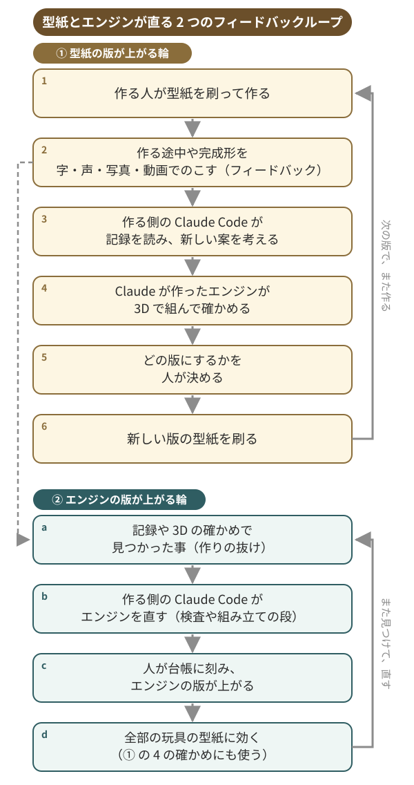

# utsushi

> うしなわれた玩具の動きを、紙でよみがえらせる

- **何か**: 学校や博物館でワークショップを開く人のための、ワークショップ支援のウェブの道具です。紙とはさみとのりだけで作れる型紙で、いろいろな年齢の人に伝えたい事を伝えられます。
- **題材**: 江戸時代のおもちゃです。江戸時代に出版された絵本に絵と音だけが残り、動きがわからなくなった玩具を、紙でよみがえらせます。玩具復活と伝統工芸継承のプロジェクトです。絵本は『江都二色』（1773）です。
- **どう直るか（フィードバックループ）**: 作る人が、作る途中や完成形を文字・音声・動画でのこします。その記録を作る側の Claude Code が読んで新しい案を考え、Claude が作ったエンジンが 3D で組んで確かめ、人が採った案が型紙の次の版になります。今回のデモで体験してもらう 2 案は、それぞれ版 14・版 7 まで、4 日間のワークショップのフィードバックで直りました。

「システムが良くなるところを Claude が担ってくれるから、人間は人間同士の関わりや工作に熱中できる。」（制作者の言葉 11-08）

## 試す

- サイト: https://utsushi.konoba.workers.dev
- 3 手で試せます。
  1. **えらぶ**: 入口で、おもちゃを 1 つ選びます。
  2. **つくる**: 型紙の PDF を刷り、切って、折って、組みます。手帖が 1 手ずつ、絵と 1 文で案内します。
  3. **のこす**: 作る途中や完成形を、字・声・写真・動画でのこします。のこした物は「もちよる」の頁に並びます（公開のサイトの写真は、人が確かめてから出ます）。
- 手元で開く: `./run-home.sh`（要る物と準備は下の「repo の地図と動かし方」）

## 何の課題か・誰のためか

- **誰のためか**: 学校や博物館などでワークショップを開く人と、そこに来るいろいろな年齢の人です。
- **課題**: 安全管理や予算の都合で、特別な道具を使えない現場は多くあります。日本の生徒は実験を多くしているのに、中学 2 年で「理科を使う職業につきたい」は 27%（国際平均 58%）です（TIMSS 2023。`docs/process/research/18-field-evidence.md`）。
### うつしの大前提

うつしは、学校や博物館などで使える、ワークショップを支えるサービスです。

伝えたい事があっても、相手の年齢も、場所も、用意できる物や予算も、さまざまです。紙と、はさみと、のりがあれば、いろいろな事を伝えられる。それが、うつしの大前提です。

11 月 4 日から 7 日まで、4 日続けてワークショップを開けたのは、紙と、はさみと、のりで作れる手軽さがあったからです。

### なぜ紙の型紙か

「もちろん紙だけでできる手軽さは最大の武器」（制作者の言葉 11-08）

なぜ紙の型紙なのか: 3D プリンタは形をそのまま出してくれますが、作る途中は機械の中にあります。紙の型紙では、切って、折って、貼る一つ一つを自分の手でするので、どこがどう動くのかが手でわかります。型紙そのものも直せます。作った人の記録から型紙が直って、次の版になります。

## 仕組み: 型紙が直るフィードバックループ

作った人の記録が、型紙を直します。作った人の記録 → 作る側の Claude Code が読んで新しい案 → Claude が作ったエンジンが 3D で確かめる → 人が採る → 新しい版を刷る、の順に回ります。



1. 作る: 作る人は、型紙を刷って、切って、折って、組みます。手帖が 1 手ずつ案内します。
2. のこす（フィードバック）: 作る途中や完成形、つまずいた所や工夫を、字・声・写真・動画でのこします。この記録が、ループの入口です。
3. 案を考える: 作る側の Claude Code が記録を読み、型紙の部品の形や組み方を直す新しい案を考えます（サイトの中で次の案を作る口は、まだ本物の鍵で呼んでいません）。
4. 3D で確かめる: Claude が作ったエンジンが、その案を 3D で組んで、紙どうしがぶつからないか、色のある面が外を向くかを確かめ（ぶつかりそうな所は、人が見るために書き残します）、組み立ての手順書も 3D で残します（今は御来迎と首振り虎）。
5. 採って刷る: どの版にするかは人が決めます。採った案が型紙の新しい版になり、次の人はその版を刷ります。こうして、作った人の記録が型紙を直し、ループが 1 周します。

4 日間のワークショップのあいだ、制作者はオフラインで人との交流と工作に熱中し、その記録を Claude に渡しました。フィードバックループのうち直す仕事は、作る側の Claude Code が後ろでして、型紙の改善が進みました。

## Claude の使い方

### サイトと作る側の道具で呼ぶ Claude

サイトの中で Claude を呼ぶのは、作る途中の質問・記録の読み（字と、動画の 3 コマ）・言葉の仮説の 3 つです。原画から仮説の案は、作る側の裏の道具で呼びます。

| 口 | する事 | 本物の鍵で |
|---|---|---|
| 作る途中の質問（`src/api/ask.py`） | 作っている途中の手順の質問に、聞かれた時だけ答える | 動いた（11-07） |
| 記録の読み・字（`src/api/loop_agents.py`） | 作った人の記録を読み、動かなかった原因の案を書く | 動いた（11-07） |
| 記録の読み・動画の 3 コマ（`src/api/observe.py`） | 記録の動画から 3 コマを取り出して見せ、見えた事と見えなかった事を書く（声は渡さない） | まだ |
| 言葉の仮説（`src/api/words.py`） | 人が打った言葉の仮説を、雛形の寸法に写す | 動いた（11-07） |
| 原画から仮説の案（`src/api/generate.py`） | 図と歌から、仕組みの仮説と寸法の案を作る（作る側の裏の道具） | 動いた（11-07） |
| 次の手の案（`src/api/loop_agents.py`） | 記録と解釈から、次の型紙の新しい仮説の案を作る | まだ |

11-07 に手元から本物の鍵で 19 回呼び、約 0.86 ドルでした（手元の使用記録より。記録は git の外）。Claude の答えは案で、人が確かめた物だけが型紙に入ります。くわしくは [docs/claude-usage.md](docs/claude-usage.md)。

### 作る側の Claude Code

- 担当ごとに Claude Code のセッションを並べ、1 担当 = 1 つの枝・1 つの git worktree で、同時に作りました。
- 作る前に設計を書き、作った担当と別のセッションが PR を読みました（すべての PR で読んだかは数えていません）。
- 合体は 11-05 の夜から 1 つの道を通し、まっさらな clone で全部の試験（`./run.sh`）が通った物だけを入れました。その道ができる前は、main の試験が落ちた事があります。
- 制作者は手元のチャットから、決める事だけをしました。
- 並べた事で速くなったか、品質が上がったかは、測っていません。
- 担当・worktree・PR の数は、提出の日に数え直して書きます。くわしくは [docs/process/claude-story.md](docs/process/claude-story.md)。

## 確かめた事と、まだの事

### 確かめた事

- ワークショップは 4 回（11 月 4・5・6・7 日）開きました。制作者の教え子の卒業生（全員成人）がのべ 30 人参加し、全員が実物の型紙を試しました（11 月 4 日の 5 人を含む。[記録](docs/process/trials/README.md)）。
- フィードバックループで直った型紙の版の歩み（版ごとに、何を直したか）は `data/history/kaizen-history.json` にあります。
- 御来迎と張子の首振り虎は、おもちゃごとに型紙を 1 枚だけ出します。開いたら、すぐ型紙を作れます。型紙は正解ではなく、Claude が考えた仮説（ためしの案）です。紙にも頁にもそう書いています。
- 型紙を見て考えを話すと、その考えに合わせて紙を作り直します。今は御来迎と虎だけです。本物の Claude では、まだ試していません。
- 検査は `./run.sh` で全部回します。凍結した基準は [tests/frozen/criteria.md](tests/frozen/criteria.md)、結果は `out/RESULT.md` に出ます（試験の数はここに書きません）。

今の数は次のとおりです（`PYTHONPATH=src .venv/bin/python -m omochae.ledger render` が tree から数えて書く）。

<!-- counts:start -->
- 玩具: 83 件（`data/hypotheses` のファイルの数。必須の 2 種を含む）
- 雛形: 9 本（`src/omochae/templates`。必須の 2 本を含む）
- 凍結の場面: 34 本（`tests/frozen/scenarios`。うち 27 本は落ちるべき紙を入れる負の場面）
- 型紙の版: 張子の首振り虎 7・御来迎 14（雛形の今の組。版ごとの歩みは `data/history/kaizen-history.json`）
- エンジンの版: 7（型紙を作る仕組みの版。全部の玩具の型紙に効く）
<!-- counts:end -->

### まだの事

- 学習の効果は主張しません。
- 3D で組んで確かめられるのは、御来迎と首振り虎だけです。
- 記録の動画の 3 コマを Claude に見せる口と、次の手の案は、まだ本物の鍵で呼んでいません。
- 手帖の頁を人が使った確かめは、まだです。
- 外の人が投稿できる所（形は Google フォームに決めた。生徒の分は集めない。[J-021](docs/process/decisions/J021-contributions-form-students.md)）は、まだ作っていません。

## 作る気持ち

制作者はずっと、紙だけでできる授業とワークショップを続けてきました。そうした授業を支えるエンジンを作りたくて、その足がかりとして江戸のおもちゃの再現から始めました。

> おもちゃを自分で作る体験は、科学で実験をすることと似ている。現象を個人的な体験とすることで喜びがあり、ひらめき、アタマを使い、科学が創られる（制作者の言葉 11-07）

> 「うつしは、絵と狂歌でしか残っていない動くおもちゃを、想像で解明するのが面白い。」
>
> 「知らない子どもが興味を持つきっかけとして、存在を知ってもらうという事はある。」
>
> 「あとは、自分の手で作り、遊び、壊し、修理できる物を作れることの喜びは、やってみないとわからない。」
>
> （制作者の言葉 11-06）

## repo の地図と動かし方

| 置き場 | 中身 |
|---|---|
| `src/web/` | サイト（入口・玩具の頁・手帖・もちよる・序の頁） |
| `src/omochae/` | 型紙の雛形・生成・検査・記録・台帳 |
| `src/api/` | Claude を呼ぶ口と道具 |
| `data/` | 出典・仮説・型紙の歩み・ワークショップの写真の表 |
| `engine/` | エンジン paper to toy（提出のためにまとめた物） |
| `tests/` | 試験と、凍結した基準（`tests/frozen/`） |
| `docs/process/` | 開発の過程（調査・判断・試行・関門の帳面） |

要る物: git、Python 3.11 以上、[uv](https://docs.astral.sh/uv/)、poppler（`pdftotext`・`pdftoppm`）、fontconfig（`fc-match`）、FFmpeg（`ffmpeg`・`ffprobe`）、字 Noto Serif CJK JP。Ubuntu 24.04 なら `sudo apt install git python3 pipx poppler-utils fontconfig ffmpeg fonts-noto-cjk`、`pipx install uv`、`export PATH="$HOME/.local/bin:$PATH"` で揃う。

```
git clone https://github.com/akihidem/utsushi.git
cd utsushi
./init.sh   # 環境を作る。足りない物があれば名指しして止まる
./run.sh # 検査を全部回す。8〜9 分かかります。結果は out/RESULT.md
```

ほかの始め方: `./run-home.sh` は家のパソコンで手元の画面を開く（`--lan` で家の網に開く）。`./run-demo.sh` はデモの一周の画面（最初の頁と手帖。置き場は本物の記録と分けた `out/demo-data`）を立て、パソコン・iPad・iPhone から開ける合言葉付きの https のリンクを作る（cloudflared が要る。止めるとリンクは変わる）。合言葉とリンクは git の外の `out/demo-key`・`out/demo-url` にだけ置く。commit に入れない。

命令のくわしい形と、できる事の全部は [docs/run.md](docs/run.md)、置き場と処理の流れは [docs/architecture.md](docs/architecture.md)、機能ごとの状態は [docs/features.json](docs/features.json)、開発の過程の入口は [docs/process/README.md](docs/process/README.md) にあります。

<details>
<summary>くわしい要約（10 項目）</summary>

<!-- summary:start -->
## 30 秒の要約

- **なぜ**: 日本の生徒は実験を国際的にとても多くしている。それでも中学 2 年で「理科を使う職業につきたい」は 27%で、国際平均 58%の半分に満たない（TIMSS 2023）。制作者は理科と探究の授業、進路指導の場で、生徒が科学を自分の手の届く物と思っていないと感じてきた（最後の文は制作者の印象で、調査の数とは分けた。[research/18](docs/process/research/18-field-evidence.md)）。
- **何か**: うしなわれた玩具の動きを、紙でよみがえらせる（入口の副題に合わせた一言。前の一言は「失われた玩具の動きを、紙で実験して確かめる道具」。紙で動いても昔の作り方の証明にはならない）。目的は科学の面白さを手元で見つける事。江戸の絵本『江都二色』（1773）に図と歌だけが残る玩具の動く仕組みを予想し、紙の型紙に刷り、紙と糸で作って確かめる。まず紙が返事をし、Claude からも返事をもらえる（子どもも直接。制作者の決定 11-04）。
- **誰と、どの場面で**: 出発は制作者の教育現場の学習活動で、制作者も使い続ける。広がりとして博物館・科学館のワークショップ、理科教育で興味や関心を引き出す人、小学校の夏休みの自由研究、公開した後は家庭の子どもと親（制作者の見立て。広がりの場面ではまだ試していない。ワークショップは 4 回（11 月 4・5・6・7 日）開き、制作者の教え子の卒業生がのべ 30 人参加し、全員が実物の型紙を試した）。価値の 1 つに、古い玩具の技術継承を置く。
- **玩具とは**: 飾る完成品でなく、手で動かして確かめられる型（トイ＝モデル）。
- **足りない物**: 手元のトイモデルで自然とやりとりする体験。無いと、大型の装置や計算資源を使う科学にしか真理がないと思ってしまう（制作者の言葉からの読み）。
- **核**: 「システムが良くなるところを Claude が担ってくれるから、人間は人間同士の関わりや工作に熱中できる。」（制作者の言葉 11-08）。その後ろで 4 つのループが回る: ①仮説を見ながら考えを話す（反応して型紙が生まれる。ループ 1）→ ②作りながら工夫を話す（型紙が直る。ループ 2。エンジンごと直る。ループ 3）→ ③できた物を上げて工夫と考えを残す（ギャラリーで見られ、型紙もシステムも直る。ループ 4）。話す口とエンジンごとの改善は作っている途中（[research/34](docs/process/research/34-talk-build-share-loop.md)）。
- **輪**: 玩具を開く → 型紙を刷る（型紙は正解でなく Claude が考えた仮説）→ 作って試す → 記録と人の工夫と説明 → 版の間に Claude が案を出し人が採る → 次の版。Claude の返事は学ぶ人の記録と説明の後で、採点しない。
- **哲学**: 「AI は鏡。江戸の絵を映すことはできるが、映すだけでは遊べない。」全文は [docs/process/philosophy.md](docs/process/philosophy.md)。
- **今の状態**: 型紙の生成と検査は動く（`./run.sh` の場面と試験が全部期待どおり。数は `./run.sh` の最後の行と `out/RESULT.md` に出る）。ワークショップは 4 回（11 月 4・5・6・7 日）。ワークショップには制作者の教え子の卒業生（全員成人）がのべ 30 人参加し、全員が実物の型紙を試した。そのうち 11 月 4 日の回は制作者の教え子の卒業生 5 人で、御来迎は前の組の紙で、筒から扇を開いて動いた。どの案の紙かは分からない。今の組の紙（御来迎 版 14・虎 版 7）も、ワークショップで実物を試した（[記録](docs/process/trials/README.md)）。試した記録は[再現ギャラリー](docs/gallery/index.html)に記録の順で並ぶ。手帖はサイトの中の頁（玩具の頁の型紙の窓の「つくる」から入る）で、作りながら声で手順を聞き、写真と動画を記録に添え、フィードバックもそこで受ける（人が使った確認はまだ）。作った物の頁もサイトの中にあり、職人の言葉は作った物の頁（もちよる）に、寄せる話の入口は序の頁（よむ）にある。本物の Claude API は、11-07 に手元で 4 つの口（聞く口・記録の読み・言葉の仮説・原画から仮説の案）を呼んで動いた（手元の使用記録で、git の外）。学習の効果は主張しない。成立の条件と今の状態は[仕様書](docs/process/spec.md)、取り込みの関門は[関門の試行の帳面](docs/process/gate-trial.md)。
- **次に読む**: 主張と根拠は [docs/process/claims.md](docs/process/claims.md)、過程の地図は [docs/process/README.md](docs/process/README.md)、機能の状態は [docs/features.json](docs/features.json)、判断待ちは [docs/process/open.json](docs/process/open.json)。
<!-- summary:end -->

</details>

## 型紙を作るエンジン（paper to toy）

型紙は、エンジン [paper to toy](https://github.com/akihidem/paper-to-toy) が作ります。エンジンは「2 次元の素材から、内部構造を持つ 3 次元の物を作るための、設計のエンジン」です（エンジンの README の字）。うつしは、paper to toy のエンジンで江戸の玩具を紙で作って試す、一つの具体例です。うつしは、みんなが使えるサービスとして作りました。エンジンの仕組みと、3D で確かめる所と、原点にある模型は、[engine/README.md](engine/README.md) にあります。

## 決まりと出典

### 開発基盤と提出物の切り分け

提出するコード・機能・データは、開発期間（2026-11-02 12:00 〜 2026-11-08 20:00 JST）中に、この repo で新規に作った。開発には、従前から運用している Claude Code の作業基盤を道具として使ったが、そのコードは含めていない。題材については開発の開始前に調査と構想の検討をしており、そのメモは参考資料として手元に置いた。この repo には入れていない。扱いは [docs/process/README.md](docs/process/README.md) に書いた。

型紙を作って検査する仕組み（`src/omochae/` の生成と検査の部分）は、期間中にエンジン paper-to-toy として別の repo にも切り出した（制作者の決定、11-04）。提出物はこの repo で、paper-to-toy は単独の提出物ではなく、1 つの提出物の中に入る。

ハッカソンの運営から、提出は 1 つの repo にするよう求められた。そこで、別の repo（[paper-to-toy](https://github.com/akihidem/paper-to-toy)）で開発しているエンジンを、提出のためにこの repo の engine/ にまとめる（制作者の決定、11-07）。まとめた後も、paper-to-toy の repo とこのリンクは残す。うつしは、みんなが使えるサービスとして作った、paper to toy のエンジンの一つの具体例にあたる。エンジンも、今回のハッカソンのために開発期間の中で作っている。うつしとエンジンの両方を、今回のハッカソンの審査の対象にしてほしい（制作者の言葉、11-07）。

- engine/ の中は、まとめた時のエンジンの main の頭 `d204a5a4a2d385e0a9fe4c78dd4c010833e58043`（2026-11-08 09:47 JST の commit）。エンジンの履歴（544 の commit）は paper-to-toy の repo で辿る。直す時と、両方の比べ方は [docs/architecture.md](docs/architecture.md) の engine/ の行にある。
- エンジンの版の台帳は engine/data/engine/versions.json。型紙の版とエンジンの版の歩みの表は `data/history/kaizen-history.json`（エンジンの記録から写した表）。

### データの扱い

repo に入れた人の記録は、11 月 4・5・6・7 日の 4 回のワークショップをまとめた記録（制作者の言葉 11-07「11/4567のまとめた記録です」）。repo に在る物は、11-04 の試行の記録 2 件とその説明と直しの記録（11-04 の参加者は制作者の教え子の卒業生 5 人・全員成人で、下ののべ 30 人に入る。つぶやきと制作者の所見）と、11-04 と 11-06 の試行の写真 43 枚と動画 1 本と、それぞれの確かめ表（制作者の決定で載せ、写真と動画は撮影の情報を外した）。ワークショップ全体では、制作者の教え子の卒業生がのべ 30 人参加し、全員が実物の型紙を試した。子どもの写真や声は扱わない。持ち寄りの投稿は確認前も確認後も git に入れない。連絡先は公開しない。

### 素材の出典

- NDL-1187053-R0000005-L『江都二色』御来迎: 国立国会図書館デジタルコレクション info:ndljp/pid/1187053（米山堂・1931 年の複製）。PDM。図を参照して寸法・形・色・線を描き直した翻案。
- NDL-1187053-R0000014-R『江都二色』張子の首振り虎: 同上。PDM。図を参照して寸法・形・色・線を描き直した翻案。
- 依存: cairosvg（LGPL-3）、shapely（BSD-3）、drawsvg（MIT）、fontTools（MIT）、jsonschema（MIT）、anthropic（Apache-2.0）、pillow（MIT-CMU）。版は `requirements.txt`。

### セキュリティ

どう守っているか、まだしていない事、弱い所を見つけた時の知らせ方は [SECURITY.md](SECURITY.md) にまとめました。弱い所は公開の Issue に書かず、そこにある非公開の道で知らせてください。公開の前の点検（2026-11-07）は、コードと依存の静的解析だけで、動かして攻撃を試してはいません。

### ライセンス

コードと文書は [MIT](LICENSE)。NDL の図と歌は上の出典の表のとおりで、MIT の対象ではない。
